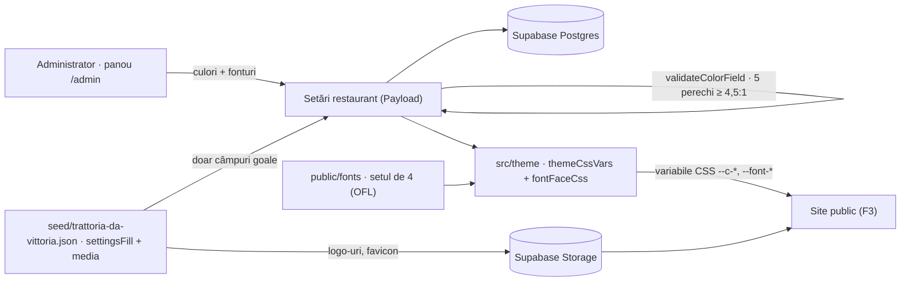
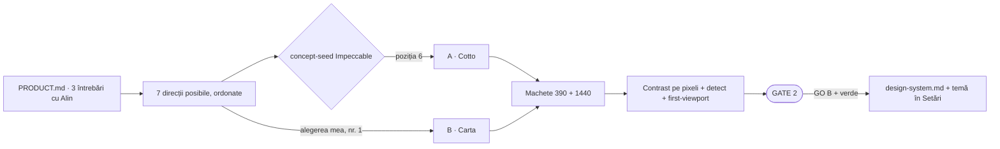
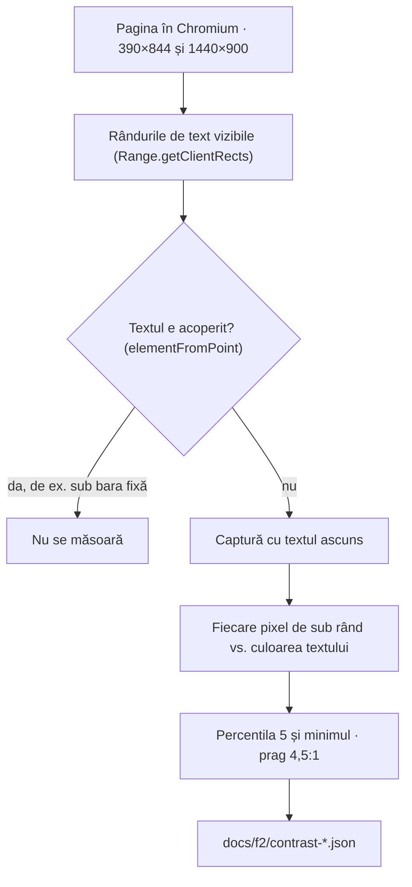
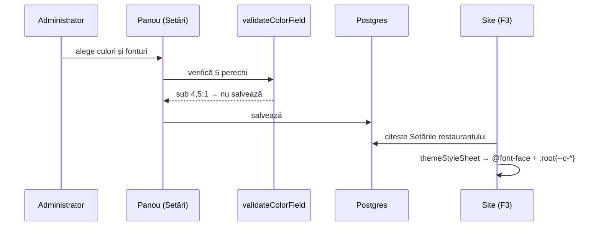
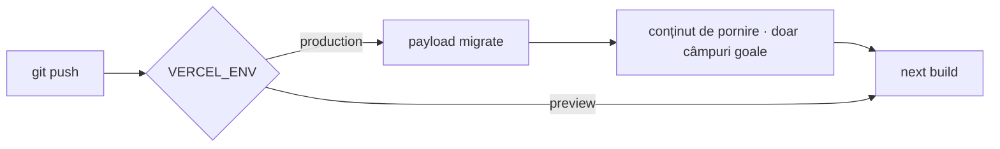

# Playbook — Trattoria da Vittoria · F2 Direcție de design

[[#TL;DR|TL;DR]] · [[#Context și obiective|Context]] · [[#Cerințe|Cerințe]] · [[#Arhitectură|Arhitectură]] · [[#Stack și unelte|Stack]] · [[#Cum s-a construit|Cum s-a construit]] · [[#Fluxuri|Fluxuri]] · [[#Prompturi|Prompturi]] · [[#Pași de reconstruire|Reconstruire]] · [[#Checklist de refolosire|Refolosire]] · [[#Lecții învățate|Lecții]] · [[#Probleme deschise și pașii următori|Pașii următori]] · [[#Surse|Surse]]

> Mod: proiect · Stare: stabil (GATE 2 cu „GO B”, 24.11.2026) · Actualizat: 2026-11-24 · Faza următoare: F3 Site public

## TL;DR

- **Ce este:** direcția vizuală a site-ului Trattoria da Vittoria, aleasă dintre două variante. Alin a ales **B · Carta**, construită ca „meniul de seară”: copertă închisă `#1C1416` cu folio auriu `#D6AE66` și pagini de hârtie `#F5EDE0`. La GO a cerut butoane verzi, deci butonul secundar e verde smarald `#14613F` (D-41).
- **Ce rezolvă:** un sistem de design pe restaurant. Culorile și fonturile se aleg în panou (Setări restaurant), iar panoul nu salvează o pereche text/fundal sub 4,5:1. Fonturile sunt gratuite, cu un set aprobat de 4 (D-42). Pictograma de filă e desenată (D-43).
- **Rezultat:** contrastul a fost măsurat pe pixelii reali de sub text. Direcția B are minimum **6,43:1 pe telefon și 5,67:1 pe desktop**, pe 82 de rânduri. Testele de integrare: **20/20**. Pe producție au ajuns migrația `f2_theme`, 4 logo-uri în Biblioteca media și tema completă în Setările Trattoriei. F2 s-a făcut într-o sesiune (estimarea: 1–2).
- **Refolosire:** un restaurant nou își alege culorile (verificate automat) și fonturile din set, apoi încarcă logo-ul și favicon-ul. Componentele citesc doar variabilele CSS din `src/theme/theme.ts`.

[[#Playbook — Trattoria da Vittoria · F2 Direcție de design|↑ Sus]]

## Context și obiective

| Aspect | Detaliu |
|---|---|
| Problemă | Site premium pentru un restaurant italian din Târgu Jiu, la nivelul de calitate al vineyard.co.za, fără să copieze referința. Panoul e refolosit de 4 restaurante (ADR-002) |
| Vizitatorul nr. 1 | Localnicii care aleg unde iau cina sau unde sărbătoresc (interviul Impeccable cu Alin, PRODUCT.md) |
| Anti-obiective (Alin) | Să nu pară „rece și intimidant”; să nu fie „kitsch italian” |
| Obiectivul F2 | Două direcții, fiecare cu Acasă pe telefon și pe desktop (hero, bara de cazare, insigna premiului), contrast măsurat. După alegere: `docs/design-system.md` și variabilele de temă pe restaurant (PLAN F2) |
| Criteriul GATE 2 | Alin alege o direcție |
| Constrângeri | Fonturi cu ș, ț, ă, â, î. Contrast ≥ 4,5:1 raportat cu cifre. Efectele, sunetul, 3D și comutatorul de temă rămân în R2 (D-33). Buget minim (D-31). O singură fază pe sesiune, direct pe `main` (D-08) |

[[#Playbook — Trattoria da Vittoria · F2 Direcție de design|↑ Sus]]

## Cerințe

| Tip | Cerință | Stare |
|---|---|---|
| Funcțională | Două direcții, Acasă pe telefon (390 px) și desktop (1440 px): hero, bara de cazare, insigna premiului | ✅ A · Cotto și B · Carta (`design/f2/`) |
| Funcțională | Pornire de la wireframe-urile S-01 / S-01b și de la `design/content-model.md` | ✅ bara fixă de jos pe telefon, insigna de 72/96 px, cazarea ca buton pe telefon |
| Funcțională | Logo-urile în Biblioteca media a Trattoriei | ✅ Trattoria, ANNA, BizTech + pictograma de filă, prin conținutul de pornire |
| Funcțională | Hero: clip și postere mai târziu, „putem genera ceva temporar” | ✅ fotografii provizorii de pe Wikimedia Commons, cu credite, marcate „Exemplu · de înlocuit” |
| Funcțională | Culori și fonturi elegante, potrivite cu logo-ul, fonturi ca pe vineyard.co.za | ✅ Optima → Belleza / Tenor Sans; PP Mori → Hanken / Host Grotesk |
| Funcțională (GO) | Butoane mai atractive, verde în loc de roșu | ✅ verde smarald `#14613F` + auriu cu luciu de folio |
| Funcțională (GO) | Variante de fonturi pentru restaurant și hotel, plus prețul fonturilor vineyard | ✅ `design/f2/fonturi.html` (8 perechi); prețurile în `docs/versions.md` F-1…F-4 |
| Funcțională (GO) | Setul de 4 fonturi, favicon desenat | ✅ `src/theme/fonts.ts`, `design/brand/favicon/` |
| Date | Setul aprobat devine câmpul de fonturi din Setări restaurant | ✅ „Font titluri” / „Font text” + migrația `20261124_143006_f2_theme` |
| Nefuncțională | Diacriticele românești în fonturi | ✅ fontTools pe fișiere: U+0218–021B, ă, â, î |
| Nefuncțională | Contrast ≥ 4,5:1 verificat și raportat | ✅ măsurat pe pixeli; panoul refuză 5 perechi sub prag |
| Nefuncțională | Lighthouse mobil ≥ 85 / ≥ 95 | ==⚠️ verify== nu se măsoară în F2 (machete statice); în F3 |
| Securitate | Nicio cheie în repo; migrațiile pe producție doar din build-ul de producție | ✅ garda `VERCEL_ENV=production` în `scripts/vercel-build.sh` |

[[#Playbook — Trattoria da Vittoria · F2 Direcție de design|↑ Sus]]

## Arhitectură

Tema e pe restaurant. Administratorul completează culorile și fonturile în Setări (Payload). Panoul validează contrastul cu aceleași reguli ca site-ul (`validateColorField`). `src/theme/theme.ts` transformă Setările în variabile CSS și reguli `@font-face`, care servesc doar fonturile alese, din `public/fonts/`. Componentele din F3 folosesc doar variabilele. La build-ul de producție, conținutul de pornire completează tema și logo-urile numai în câmpurile goale. Machetele și instrumentele de verificare (contrast, Impeccable) stau în afara aplicației: `design/f2/`, `scripts/f2/`.



[[#Playbook — Trattoria da Vittoria · F2 Direcție de design|↑ Sus]]

## Stack și unelte

| Strat | Unealtă / serviciu | Versiune | De ce | Cost / licență |
|---|---|---|---|---|
| Aplicație | Next.js + Payload CMS (din F0/F1) | 16.4.6 / 3.94.1 | Stackul aprobat (D-23) | conturile Pro existente |
| Skill design | Impeccable (`npx impeccable install`) | 4.10.0, motor 0.1.27 (SHA-256 verificat) | Interviu `PRODUCT.md`, `concept-seed`, craft-floor, detector, `first-viewport`, contractul direcției | Apache-2.0, gratuit |
| Skill design | Taste (`design-taste-frontend`) | 2.5.1, commit `6c0b5c7` | Reguli pentru localuri, căutare de fotografii provizorii (`photos.mjs`) | gratuit |
| Skill design | UI UX Pro Max (`ui-ux-pro-max-cli`) | 2.15.0 | Căutare `--design-system`, baza de fonturi Google, lista de verificare | gratuit |
| Skill design | design-elevation (design-skills) | ==⚠️ verify== versiunea pluginului | Protocolul de rafinare | gratuit |
| Proces | superpowers:brainstorming | ==⚠️ verify== versiunea pluginului | Pornire; închis pentru că Alin a cerut lucru autonom | gratuit |
| Fonturi | Belleza, Tenor Sans, Hanken Grotesk, Host Grotesk (`@fontsource/*`) | 5.3.0 | Cele mai apropiate de Optima + PP Mori, cu diacritice RO | OFL 1.1, 0 USD |
| Fonturi | Alex Brush | 5.3.0 | Litera „V” din favicon, convertită în contur | OFL 1.1 |
| Verificare fonturi | fontTools (Python) | 4.68.0 | Verificarea U+0218–021B în fișiere | MIT, gratuit |
| Capturi și contrast | Playwright + Chromium (din container) | 1.63.0 | Machete, capturi 390/1440, măsurarea pe pixeli | Apache-2.0 |
| Fotografii provizorii | Wikimedia Commons (prin Taste `photos.mjs search/fetch`) | — | 5 fotografii cu licență liberă (CC0, CC BY, CC BY-SA), cu credite | gratuit, cu atribuire |
| Generare imagini | Hugging Face (FLUX.1-Krea-dev) | — | Încercat; `invoke` dezactivat în sesiune (`gradio=none`) | — |
| Conectori | Vercel MCP, Supabase MCP, Artifact | — | Verificarea deploy-urilor, SQL doar de citire, publicarea paginilor | — |

[[#Playbook — Trattoria da Vittoria · F2 Direcție de design|↑ Sus]]

## Cum s-a construit

| Ora (UTC) | Commit | Pas |
|---|---|---|
| 13:29 | `22083c5` | Skill-urile Impeccable, Taste și UI UX Pro Max instalate în proiect (și global, în containerul cloud). Interviul Impeccable (3 întrebări) → `PRODUCT.md` |
| 14:00 | `a373348` | Două direcții, A · Cotto și B · Carta (`design/f2/`). Fonturile verificate, fotografiile provizorii, scripturile de contrast și capturi, logo-urile în conținutul de pornire (test nou, 2/2) |
| 14:08 | `d54ad82` | Raportul GATE 2 și pagina de comparație (publicată ca artifact). Producția: 3 logo-uri, Logo principal și Logo grup completate |
| 14:09 | `2ea21dc` | Rezultatul de pe producție notat în raport |
| — | — | **GATE 2: „GO B”**, cu verde la butoane, variante de fonturi, setul de 4 și favicon |
| 14:36 | `51e4c6e` | Butoane verzi, planșa de 8 perechi de fonturi, favicon, `src/theme`, câmpurile din Setări, migrația `f2_theme`, `docs/design-system.md`. Teste 20/20 |
| 14:37 | `e732e42` | Garda de build: migrațiile și conținutul de pornire doar la producție (după incidentul cu preview-ul) |
| 14:39 | `4464a1a` | Excepția detectorului pentru planșa de fonturi (crem aprobat în D-41) |

**Decizii cheie**

| Decizie | Opțiuni | Aleasă | Motiv |
|---|---|---|---|
| Cum se aleg direcțiile | 7 direcții ordonate de mine; tragerea la sorți Impeccable; propunerea UI UX Pro Max | Tragerea Impeccable (poziția 6 → A · Cotto) + alegerea mea nr. 1 (B · Carta) | Regula Impeccable: direcția trasă + o singură alegere a autorului; exact cele două cerute de Alin |
| Direcția | A · Cotto (zi, teracotă) / B · Carta (seară, copertă și folio) | **B** (Alin, D-41) | Vizitatorul nr. 1 vine la cină; vinurile și premiul în față |
| Culoarea butonului secundar | Bordo `#7B2333`; verdele din steag `#036625`; smarald `#14613F`; basilico `#2E6B45` | **Smarald** | Cererea lui Alin. Verdele din steag ieșea prea strident; smaraldul are 6,43:1 și se potrivește cu auriul |
| Fonturi | Optima Nova + PP Mori (plătite) / echivalente OFL | **OFL** (D-42) | ≥ 178 USD în primul an pentru un singur restaurant; PP Mori se reînnoiește anual |
| Setul aprobat G3 | Doar perechea aleasă / toate 4 cele verificate | **4** (D-42) | Fiecare restaurant alege fără cod nou |
| Câmpurile de culoare | 4 câmpuri (F1) / 6 roluri | **6 roluri** + 5 perechi verificate | Direcția B are fundal închis și text pe el; contrastul se verifică pe fiecare pereche folosită |
| Fotografii provizorii | Generare AI / Wikimedia Commons / pete de culoare | **Wikimedia** | Generarea nu mergea în sesiune; Taste recomandă fotografii cu licență, nu fundaluri goale |
| Fonturile pe site | `next/font/local` / `public/fonts` + `@font-face` generat | **`public/fonts`** | Fontul se alege la runtime, pe restaurant; se descarcă doar fonturile alese |
| Migrațiile la build | Pe orice build / doar la producție | **Doar producție** | Preview-ul folosește aceeași bază de date (incidentul din F2) |

[[#Playbook — Trattoria da Vittoria · F2 Direcție de design|↑ Sus]]

## Fluxuri

**1. Cum s-a ales direcția**



**2. Măsurarea contrastului pe randare (`scripts/f2/contrast-measure.mjs`)**



**3. Tema unui restaurant, de la panou la site**



**4. Build-ul pe Vercel, după garda din F2**



[[#Playbook — Trattoria da Vittoria · F2 Direcție de design|↑ Sus]]

## Prompturi

> [!example]- Promptul F2 — scris de Alin, 24.11.2026 (cu cele 3 logo-uri atașate: ANNA, BizTech, Trattoria)
> ```text
> Continuăm proiectul Trattoria da Vittoria. Citește CLAUDE.md, docs/DECISIONS.md, docs/ADR.md, docs/PLAN.md, docs/OPEN-QUESTIONS.md și tot ce s-a adăugat în docs/ de la ultima fază (docs/2026_11_24_Trattoria_GATE1.md, docs/materiale-necesare.md, docs/versions.md, docs/img/). Spune-mi în 5 rânduri unde am rămas, pe baza fișierelor și a istoricului git.
>
> Apoi rulează Faza 2 din docs/PLAN.md (Direcție de design), pas cu pas, cu aceleași reguli ca până acum: o singură fază, te oprești la GATE 2, raportezi cifre reale și aștepți „GO”. Lucrezi autonom pe main; mă oprești doar unde e nevoie de mine.
>
> Pentru F2:
> - Pornești de la wireframe-urile din design/ și de la design/content-model.md. Referința vineyard.co.za e nivel de calitate, nu model de copiat.
> - Înainte să folosești un skill de design (Taste, Impeccable, UI UX Pro și celelalte instalate), citește-i documentația și folosește doar comenzile și componentele pe care le returnează efectiv.
> - Materialele de brand (logo-uri,) le adaugam în Biblioteca media a restaurantului Trattoria. 
> -clipul și posterele pentru hero le adaugam mai tarziu, putem genera ceva temporar
> -culori, fonturi vreau sa imi propui ceva elegant care sa se potriveasca cu logoul nostru si tema italiana, fonturile imi plac cele de pe  [vineyard.co.za](https://www.vineyard.co.za/)
> Ce lipsește, lucrezi pe conținut provizoriu marcat „Exemplu · de înlocuit” și îmi spui exact ce lipsește, cu calea din docs/materiale-necesare.md.
> - Fonturile alese acoperă diacriticele românești (ș, ț, ă, â, î). Setul aprobat devine câmpul de fonturi din Setări restaurant (amânat din F1).
> - Contrast text/fundal minimum 4,5:1, verificat și raportat cu cifre. Efectele sezoniere, sunetul, 3D și comutatorul de temă rămân în R2 (D-33).
> - Livrabile: două direcții, fiecare cu Acasă pe telefon și pe desktop (hero, bara de cazare, insigna premiului), apoi docs/design-system.md și variabilele de temă pe restaurant pentru direcția aleasă.
>
> GATE 2: îmi arăți cele două direcții, cu contrastele măsurate, și aștepți să aleg una.
> ```

> [!example]- Cererea din timpul lucrului — instalarea skill-urilor (Alin)
> ```text
> instaleaza aici la proiect si global Taste, Impeccable și UI UX Pro si folosestele cum e mai recomandat
> ```

> [!example]- Comenzile de instalare folosite (recomandate de autori)
> ```bash
> npx -y impeccable@4.10.0 install --providers=claude --scope=project -y
> npx -y impeccable@4.10.0 install --providers=claude --scope=global -y
> npx -y skills@1.9.0 add https://github.com/Leonxlnx/taste-skill --skill design-taste-frontend -a claude-code -y
> npx -y skills@1.9.0 add https://github.com/Leonxlnx/taste-skill --skill design-taste-frontend -a claude-code -g -y
> npx -y ui-ux-pro-max-cli@2.15.0 init --ai claude
> npx -y ui-ux-pro-max-cli@2.15.0 init --ai claude --global
> ```

> [!example]- Interviul Impeccable pentru PRODUCT.md — întrebările și răspunsurile lui Alin
> ```text
> 1. „Trattoria da Vittoria (F2, direcția de design): cine este vizitatorul nr. 1 pe care trebuie să-l convingă pagina Acasă în primele 5 secunde?”
>    → „Localnici, cină și ocazii”
> 2. „Trattoria da Vittoria: ce poate spune adevărat Trattoria și niciun alt restaurant din Târgu Jiu nu poate? (alege 1–2)”
>    → „cursuri de pizza pentru copii,Vinurile,Bucătăria italiană autentică,Totul într-un loc, Grupul ANNA,Serile și atmosfera”
> 3. „Trattoria da Vittoria: ce ar face site-ul să pară greșit pentru voi, chiar dacă arată „frumos”?”
>    → „Rece și intimidant,Kitsch italian”
> ```

> [!example]- GO la GATE 2 (Alin)
> ```text
> GO B, dar culorile butoanelor sa fie mai atractive (poate putem folosi o paleta de verde pentru cele rosii ?)fonturi gratuite dar as mai vrea cateva variante de font prezentate potrivite pentru restaurant/hotel (+i cat ar costa fonturile wineyard), setul de 4, desenează tu favicon-ul
> ```

> [!example]- Contractul direcției B — .impeccable/surfaces/design-f2-directia-b-carta-html.md (pentru verificarea finală din F3)
> ```text
> THESIS: Acasă e meniul de seară al casei: o copertă închisă cu folio care se deschide în pagini de hârtie. Refuză hero-ul generic cu fotografie și buton centrat peste un gradient negru.
> OWN-WORLD: copertă #1C1416, folio #D6AE66 (din inelul logo-ului, cu luciu pe butonul principal), hârtie #F5EDE0, cerneală #241A17, verde smarald #14613F pentru butonul secundar. Belleza la titluri, Hanken Grotesk la text. Chenar dublu de folio pe copertă, rânduri de meniu cu linie de puncte, butoane-pastilă.
> STORY: vizitatorul vede focul și masa, înțelege că e cel mai bun loc din oraș (tagline-ul, insigna premiului) și rezervă; apoi răsfoiește meniul, vinurile, cazarea și serile.
> FIRST VIEWPORT: fotografia sau clipul pe toată lățimea, umbră caldă din stânga; în stânga tagline-ul mare, insigna rezervată 96 px (72 px pe telefon), subtitlul, „Rezervă o masă” (auriu) și „Meniu”; jos fâșia de hârtie a cazării. Pe telefon acțiunea stă în bara fixă de jos.
> FORM: Carta dei vini, poziția 1 din 7 (alegerea Impeccable; tragerea a dat poziția 6, Cotto); aleasă de Alin la GATE 2 (GO B, 24.11.2026). seed:a309c5956e16fe6f
> FINISH: unreviewed and undocumented is unfinished; this build ends with the finish review, the verdict, DESIGN.md, and every shipping raster carrying its provenance
> ```

> [!example]- Promptul F3 — propunere pentru sesiunea următoare (și în docs/META-PROMPT.md)
> ```text
> Continuăm proiectul Trattoria da Vittoria. Citește CLAUDE.md, docs/DECISIONS.md, docs/ADR.md, docs/PLAN.md, docs/OPEN-QUESTIONS.md și tot ce s-a adăugat în docs/ de la ultima fază (docs/2026_11_24_Trattoria_GATE2.md, docs/design-system.md, docs/materiale-necesare.md, docs/versions.md), plus PRODUCT.md și .impeccable/surfaces/. Spune-mi în 5 rânduri unde am rămas, pe baza fișierelor și a istoricului git.
>
> Apoi rulează Faza 3 din docs/PLAN.md (Site public), pașii 1–3: antet, navigare și footer; hero cu bara de cazare; secțiunea Restaurant (categorii, vinuri recomandate, recenzii). Aceleași reguli ca până acum: te oprești după pasul 3, raportezi cifre reale și aștepți „GO”. Lucrezi autonom pe main; mă oprești doar unde e nevoie de mine.
>
> Pentru F3:
> - Construiești pe direcția B · Carta din docs/design-system.md și pe tema din src/theme: culorile și fonturile se citesc din Setări restaurant; nimic specific Trattoriei în componente.
> - Folosești skill-urile de design instalate (Impeccable, Taste, UI UX Pro Max) cum recomandă documentația lor; contractul direcției e în .impeccable/surfaces/.
> - Conținutul vine din panou; ce lipsește rămâne „Exemplu · de înlocuit” și îmi spui ce lipsește, cu calea din docs/materiale-necesare.md.
> - Măsori și raportezi: contrastul pe randare (scripts/f2/contrast-measure.mjs) și Lighthouse pe mobil (performanță ≥ 85, accesibilitate ≥ 95).
> ```

Regulile proiectului (`CLAUDE.md`, masterprompt) sunt neschimbate; textul complet e în Playbook F1.

[[#Playbook — Trattoria da Vittoria · F2 Direcție de design|↑ Sus]]

## Pași de reconstruire

De la zero, local, pe o bază Postgres proprie (testele refuză orice bază care nu e locală):

1. `git clone https://github.com/challymcchallenge/anna-restaurante && cd anna-restaurante`
2. `pnpm install --frozen-lockfile` (Node ≥ 22.23.5, pnpm 10.28.0)
3. Pornește Postgres și creează o bază locală. Exportă `DATABASE_URI=postgres://<user>:<parolă>@localhost:5432/<baza>` și `PAYLOAD_SECRET=<orice-text-local>`. Valorile reale nu intră în repo.
4. `pnpm payload migrate` (include `20261124_143006_f2_theme`) și `pnpm generate:types`
5. `pnpm test:int` → 20/20 (F1 13, API 1, logo-uri 2, temă 4)
6. Machetele: deschide `design/f2/directia-b-carta.html` și `design/f2/fonturi.html` în browser
7. Contrastul: `node scripts/f2/contrast-measure.mjs design/f2/directia-b-carta.html "B" docs/f2/contrast-b-carta.json` (adaugă `dark` ca al 4-lea argument pentru tema închisă)
8. Capturile: `node scripts/f2/capture.mjs design/f2/directia-b-carta.html design/f2/capturi/f2-b-carta`
9. Verificările Impeccable: `.claude/skills/impeccable/scripts/impeccable detect design/f2/directia-b-carta.html` și `… first-viewport design/f2/directia-b-carta.html --thesis ".hero" --action ".hero-actions .btn-primary"`
10. `pnpm build` local, apoi push pe `main`. Vercel rulează migrația și conținutul de pornire doar la producție.
11. Skill-urile pe un calculator nou: comenzile din „Comenzile de instalare folosite”, cu `--scope=global` / `-g` / `--global`

[[#Playbook — Trattoria da Vittoria · F2 Direcție de design|↑ Sus]]

## Checklist de refolosire

Pentru un restaurant nou al grupului (Citybar, SuperBistro, Terasa Anna):

- [ ] Logo-ul principal, logo-ul grupului și pictograma de filă în Biblioteca media (sau în `seed/<slug>.json` → `media` + `settingsMedia`)
- [ ] Culorile în Setări → Culori (6 roluri). Panoul refuză o pereche sub 4,5:1
- [ ] „Font titluri” și „Font text” din setul aprobat; un font nou intră doar după verificarea U+0218–021B și o migrație
- [ ] Fotografiile proprii în locul celor provizorii (formatele HERO-L/P, CARD-P, CARD-L)
- [ ] Măsurarea contrastului pe paginile reale (`scripts/f2/contrast-measure.mjs`)
- [ ] Licențele: fonturile OFL se pot folosi pe toate domeniile; fonturile plătite cer licență pe fiecare domeniu

Pentru un alt client (alt proiect):

- [ ] Interviul Impeccable → `PRODUCT.md` (vizitatorul nr. 1, diferențele, anti-obiectivele)
- [ ] `concept-seed` + 7 direcții ordonate; arăți direcția trasă și alegerea ta
- [ ] Fonturile: `npm pack @fontsource/<font>` + fontTools pe limbile clientului
- [ ] Contrastul măsurat pe randare, nu doar pe perechile de culori
- [ ] Garda `VERCEL_ENV=production` dacă preview-urile folosesc baza de producție

[[#Playbook — Trattoria da Vittoria · F2 Direcție de design|↑ Sus]]

## Lecții învățate

| Ce | Lecția |
|---|---|
| Skill-urile cerute lipseau din sesiunea cloud | Se instalează la cerere, cu comanda autorului. Globalul din container dispare la închidere; doar instalarea în proiect rămâne (salvată în repo) |
| 9 din 17 fișiere WebP descărcate de Taste erau corupte | Fiecare imagine descărcată se decodează (PIL) înainte de folosire; cele corupte s-au refăcut din sursa Wikimedia |
| Wikimedia: miniaturile de 400 px dădeau 400; descărcarea în paralel era limitată | Lățimi standard (500 / 960 / 1280 / 1920), descărcare secvențială cu reîncercări |
| Detectorul static Impeccable a dat contrast fals (textul crem comparat cu fundalul paginii) | Contrastul se măsoară pe randare, pixel cu pixel. Excepțiile se notează îngust, pe fișier, cu motiv și dovadă |
| Textul de sub bara fixă de jos ieșea „2,5:1” | Verificare de vizibilitate (`elementFromPoint`) înainte de măsurare |
| Telefonul și „RO” din antet stăteau peste tencuiala luminoasă (4,18 / 4,29) | Umbra de sus întărită → 7,71 / 7,84. Fără măsurare pe pixeli, problema nu se vedea |
| `tsc` a prins o eroare de tip care ar fi stricat build-ul Vercel | Înainte de push: `tsc`, testele, `pnpm build` local |
| Un preview a rulat aceeași migrație pe baza de producție, în paralel | Migrațiile și conținutul de pornire rulează doar la `VERCEL_ENV=production`; verificat pe ambele build-uri |
| Marcellus, Italiana, Della Respira și Cagliostro n-au ș și ț cu virgulă | Fontul se verifică în fișier (cmap), nu după „latin-ext” din listă |
| Verdele pe copertă: 2,42:1 | Pe fundalul închis butonul rămâne auriu; verdele doar pe hârtie |
| Taste interzice telefoanele reale și hero-urile întunecate la localuri | Regulile proiectului (D-17) și brief-ul câștigă; conflictul se notează |
| Prettier a reformatat fișiere mai vechi (printWidth 100) | Diferențe mari la primul commit; de rulat o dată pe tot repo-ul, separat |

[[#Playbook — Trattoria da Vittoria · F2 Direcție de design|↑ Sus]]

## Probleme deschise și pașii următori

- **F3 · Site public**, într-o sesiune nouă: promptul e mai sus și în `docs/META-PROMPT.md` (pașii 1–3).
- **G2-5 (opțional):** o variantă de font din `design/f2/fonturi.html` în locul perechii Belleza + Hanken Grotesk.
- **Materiale** (`docs/materiale-necesare.md`): clipurile și posterele hero (#7–9), fotografiile de seară în locul celor provizorii (#31).
- ==⚠️ verify== durata licenței web Optima Nova (MyFonts: „majoritatea” licențelor web sunt anuale) și prețul exact PP Mori pe afișări. Nu sunt necesare cât timp rămân fonturile gratuite.
- **Lighthouse pe mobil:** se măsoară în F3, pe paginile reale.
- **La finalul F3:** revizia de final Impeccable și `DESIGN.md` scris din site-ul construit (linia FINISH din contract).

[[#Playbook — Trattoria da Vittoria · F2 Direcție de design|↑ Sus]]

## Surse

- Repo: https://github.com/challymcchallenge/anna-restaurante (main, `22083c5`…`4464a1a`)
- `docs/2026_11_24_Trattoria_GATE2.md`, `docs/design-system.md`, `docs/DECISIONS.md` (D-41…D-43), `docs/PLAN.md`, `docs/versions.md`, `docs/materiale-necesare.md`, `docs/META-PROMPT.md`
- `PRODUCT.md`, `.impeccable/surfaces/design-f2-directia-b-carta-html.md`, `.impeccable/config.json`
- `design/f2/` (machete, capturi, `fonturi.html`), `design/brand/favicon/`, `docs/f2/contrast-*.json`
- `src/theme/`, `src/collections/Settings.ts`, `src/migrations/20261124_143006_f2_theme.ts`, `scripts/vercel-build.sh`, `tests/int/f2-*.int.spec.ts`
- Pagina de comparație (privată): https://claude.ai/artifact/EdsBx1Fghq6us6soUPfBG5
- Deploy-uri Vercel: `dpl_9YX6qkL7k2aDqxo1MzorMUpiiJKB`, `dpl_B9f94cbyAu26Lz9iF5Dez9fJDqL4`, `dpl_Bzygf5oQfeYipoRuXcVWwY1tfd3G` (producție); `dpl_6m1jJb8Tn4bJVnpQW26QbXY9rBpW` (preview eșuat), `dpl_AYhq3a7ye5r3dAE89LVNKyV8sWqj` (preview cu gardă)
- Prețuri: https://www.myfonts.com/products/pro-regular-optima-nova-lt-1078902, https://pangrampangram.com/products/mori, https://pangrampangram.com/pages/faq (citite pe 24.11.2026)
- Conversația Claude Code din 24.11.2026, sesiunea F2

[[#Playbook — Trattoria da Vittoria · F2 Direcție de design|↑ Sus]]

---

100% AI Solutions & Agentic Work-Flows for SMEs
Made with ❤️ by BizTech Consulting SRL
Alin Labau - AI Project Manager | +40 772 295 031 | www.biztech.ro
